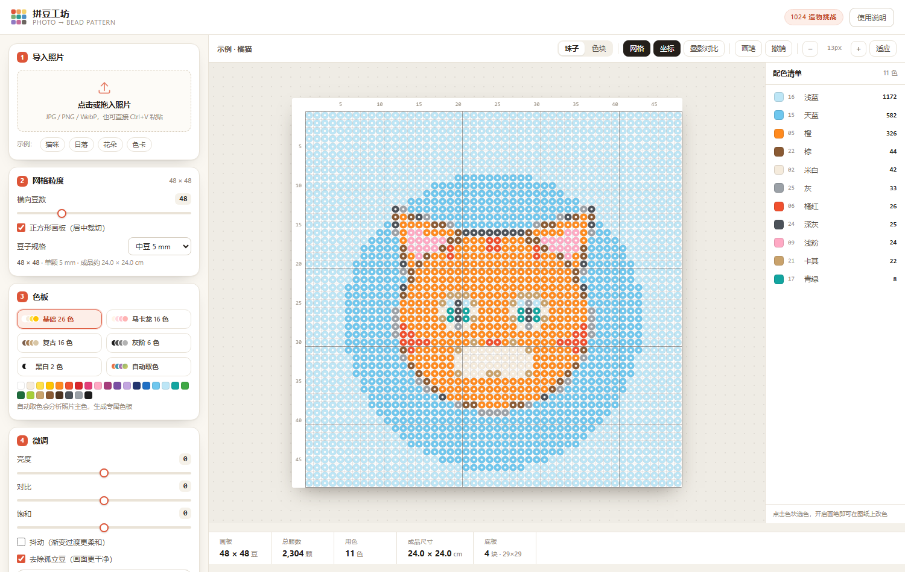

# 拼豆工坊 · Bead Studio

**把一张照片，变成一张可以照着摆豆的图纸。**

<p>
  
  
  
  
</p>

导入照片 → 自动提取主色、量化成像素网格 → 调色板 / 调粒度 → 导出带色号图例与坐标刻度的拼豆图纸。

**纯前端单文件，双击 `index.html` 就能用，照片不会上传到任何服务器。**



## 在线体验

<https://bead-studio-21694.app.workbuddy.host/?sharecode=ONKNUUQ535>（直接点击，其余不用管！！！）

## 核心功能

| 环节 | 能力 |
| --- | --- |
| 导入 | 点选、拖拽、`Ctrl+V` 粘贴；内置 4 张示例图便于快速体验 |
| 识别 | 中位切分 + K-means 聚类自动提取照片主色，生成专属色板 |
| 量化 | 在 CIELAB 空间做最近色匹配，可选 Floyd–Steinberg 抖动与孤立豆去除 |
| 粒度 | 横向 12–160 豆可调，按原图比例推算行数，支持正方形居中裁切 |
| 色板 | 基础 26 色 / 马卡龙 16 色 / 复古 16 色 / 灰阶 6 色 / 黑白 2 色 / 自动取色 |
| 预览 | 珠子（带孔）与色块双视图、网格、双向坐标刻度、叠影对比原图、无损缩放 |
| 改色 | 从配色清单选色，用画笔在图纸上直接改色，支持撤销 |
| 导出 | PNG 图纸（标题 + 规格信息 + 色号图例 + 每 10 格粗线 + 双向坐标）、CSV 配色清单 |

## 快速开始

不需要安装任何东西，也不需要构建：

```bash
git clone https://github.com/vanelee0958-max/bead-studio.git
cd bead-studio
# 直接双击 index.html
```

或起一个本地静态服务：

```bash
python -m http.server 8000
# 打开 http://localhost:8000
```

## 参数怎么选

- **横向豆数**：48 左右适合 15–25cm 摆件；80–110 适合大幅挂画；160 接近照片细节。
- **豆子规格**：中豆 5mm（最常用）、小豆 2.6mm、大豆 10mm，成品尺寸随设置实时换算。
- **底板**：按 29×29 通用底板估算所需块数。
- **抖动**：渐变色（天空、皮肤）打开更柔和；主体边界清晰的图建议关闭。
- **去除孤立豆**：清理量化产生的零星杂点，出图更干净。

## 技术实现

- 单文件、零依赖、零构建，Canvas 2D 全程在浏览器本地运算。
- 缩小采样采用逐级折半降采样，避免大图直接缩放产生的摩尔纹与偏色。
- 颜色距离在 CIELAB（≈CIE76，a/b 通道加权）空间计算，比 RGB 欧氏距离更接近人眼判断。
- 自动色板：中位切分初始化 → 3 轮 K-means 收敛 → 去重。
- 图纸导出按网格尺寸动态排布版式，网格、坐标尺、图例三栏自适应，图例过长时自动加高画布。
- 响应式：窄屏自动切换为「画布在前、控制面板在后」的堆叠布局。

## 部署到 GitHub Pages

本仓库根目录就是 `index.html`，可以直接托管：

1. 推送到 GitHub 后进入仓库 **Settings → Pages**
2. **Source** 选 `Deploy from a branch`
3. 分支选 `main`，目录选 `/ (root)`，保存
4. 等一两分钟，访问 `https://<你的用户名>.github.io/bead-studio/`

## 项目结构

```
bead-studio/
├── index.html    # 应用本体（HTML + CSS + JS 全在这一个文件里）
├── preview.png   # 界面截图
├── README.md
└── LICENSE
```

## URL 参数

方便演示与截图：

| 参数 | 说明 |
| --- | --- |
| `?sample=cat\|sunset\|bloom\|test` | 指定载入的示例图 |
| `?cols=96` | 指定横向豆数 |
| `?auto=1` | 以自动取色模式启动 |

## 说明

本项目为 WorkBuddy「1024 造物挑战」程序员节应用创作大赛参赛作品。示例图由程序绘制，用于展示量化效果。

## License

[MIT](LICENSE)
